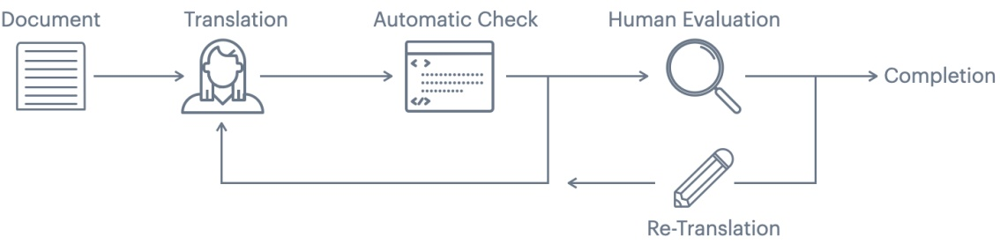
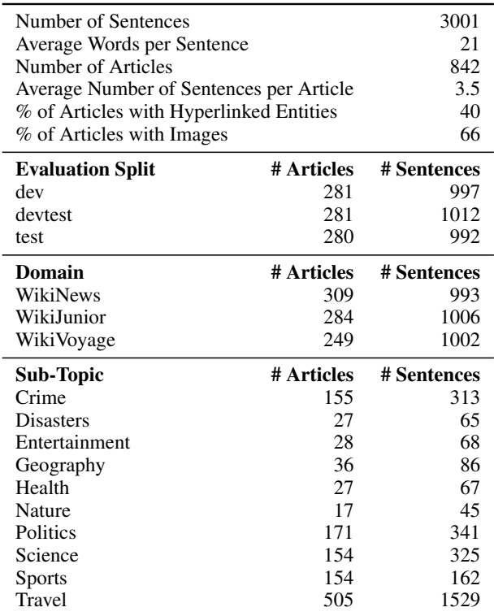
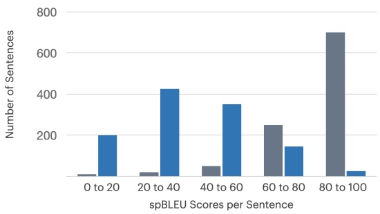

Figure 2: Depiction of Overall Translation Workflow. For each target language, sentences are translated by a translation Language Service Provider (LSP). The resulting translations are automatically checked. If these checks fail, translations are sent back for re-translation. If the automatic checks pass, translations are sent to another LSP for human evaluation. If the quality is not sufficient, translations are sent back to the original translation LSP for re-translation. Depending on the human score, the process can repeat for multiple rounds of human evaluation.

Table 1: Statistics of FLORES-101. FLORES-101 contains 3001 sentences selected from 842 articles, divided into three splits: dev, devtest, and test. The articles are sourced from three domains, breaking down into 10 sub-topic classifications.

## 3.2.1 Providers and Workflows

To ensure the best possible level of quality for our translations, we designed two pilots aimed to de termine the best workflow to follow for translating hundreds of languages. The first pilot experiment was meant to select the best translation providers for each language and the second, to determine the best translation-quality assurance workflow.

**Language Service Providers.** As a starting point, let us assume that each language can be translated by K different Language Service Providers (LSPs) and that they all charge the same price for translating a sentence. We randomly selected 100 sentences and 8 language pairs, and assigned each language to at least two LSPs. We then used another LSP to evaluate all translations.

Based on human assessment of translation quality, we selected the two LSPs that produced the highest quality translations. We chose two translation LSPs to make our translation process not rely entirely on a single-party, while reducing the communication overhead created by working with too many external parties.

**Translation and Quality Assurance Workflow.** Despite having reliable translation LSPs, we need to ensure that each translation conforms to the highest level of quality required by a benchmark. Therefore, we split our workflow into two parts: translation (which includes editing), performed by an initial LSP, and quality assurance (QA) performed by an independent LSP. After the QA process, a translation might need re-translation or minimal editing to improve its quality. Here, we explored the best workflow for when re-translation is needed. Assuming there are two translation LSPs, A and B, and a separate QA LSP C, we can have two possible workflows: (i) **A–C–B** we can have B re-translate translations flagged by C that were produced by A; (ii) **A–C–A** an alternative and simpler workflow is to have the same LSP take care of both translation and re-translation for a given language, and to have each translation LSP handle half of the languages.

The advantage of workflow (i) is the retranslation process is the least biased, particularly on low-resource languages where the re-translator and the translator could be the same person. On the other hand, the re-translator has less context and the workflow has higher complexity because data comes in and out of LSPs at different times, making the whole process more error prone.

We tested both workflows and observed negligible differences between the two workflows, and therefore, we chose workflow (ii) , i.e. A–C–A, with the same LSP taking care of both translation and re-translation as it is operationally simpler.

## 3.2.2 Automatic Translation Quality

The second pilot experiment aimed to investigate how to assess translation quality automatically.

**Implemented Checks.** We implemented several checks to ensure the first round of translations were of acceptable quality: (i) language identification, (ii) checking whether the translation is a copy of the source sentence; (iii) checking whether the translation has significantly different length, (iv) checking translation fluency according to a language model, (v) and checking whether the translation is a copy of the translation produced by publicly available translation engines. Among all checks, we found that (v) was the most significant issue, despite formulating clear guidelines forbidding the use of translation engines. This is important, as we want to our translations to be as unbiased as possible. Relying on verbatim or post-edited translations from online engines would be misguiding, and give them unfair advantage when using a reference-based automatic metric for comparison.

To address the issue, we proposed a heuristic to detect and reject professional translations that are likely copies from translation engines based on their sentence-level similarity. Moreover, when the translations of two different engines are available, we check whether a sentence is very similar to the output of a specific translation engine while being different from the output produced by other translation engines.

The heuristic is as follows: let x be the translation produced by a translation LSP, $y _ { A }$ and $y _ { B }$ be translations produced by translation engine A and B; and let spBLEU(x, y) be the sentence-level SentencePiece BLEU (cfr. Sec. 5) between sentence x and the reference y. Then, we declare a that a translation was a copy if $\begin{array} { r l } { \mathtt { s p B L E U } ( x , y _ { A } ) \quad - \quad \mathtt { s p B L E U } ( x , y _ { B } ) } & { > } \end{array}$ 20 and $\mathtt { s p B L E U } ( x , y _ { A } ) { > } 5 0$ , when the language in question is supported by both engines A and B; and if $\mathbf { s p B L E U } ( x , y _ { A } ) > 5 0$ when the translation is only supported by translation engine A.

Figure 3: Importance of Automatic Checks. In gray, we show the sentence-level spBLEU of a language that displays indication of copy from a commercial translation engine. A large number of sentences have very high BLEU scores, mainly in the 80 to 100 BLEU bucket. In contrast, the bars in blue indicate a language that does not experience this issue. We discuss the sp-BLEU metric in greater detail in Section 5.

| # of Languages requiring Re-translation | 45 |
| --- | --- |
| Avg # of Re-translations | 1 |
| Max # of Re-translations | 3 |
| Avg # of Days to Translate 1 language | 26 |
| Avg # of Days to Re-Translate | 35 |
| Avg # of Days for 1 language | 61 |
| Shortest Turnaround (days) for 1 language | 31 |
| Longest Turnaround (days) for 1 language | 89 |

Table 2: Statistics of FLORES-101 Translation Workflow. To ensure high quality, our translation workflow includes translation and re-translation steps. We break down the amount of re-translation required, and summarize that to complete one language, it takes on average two months.

The values of 50 and 20 were based on the analysis of the distribution of scores for translations of tens of languages, where we used clustering techniques to determine the right cutoff values.

Moreover, we established that any set of translations with more than 10% of the sentences violating the above criteria condition would need to be retranslated prior to perform any subsequent human evaluation. We show in Figure 3 an example of a language that passed this test and one which did not. Thanks to these automatic checks, we reduced the amount of copying from popular translation engines, streamlined the translation workflow before human evaluators assessed quality, and fully automated the process of translation, evaluation, and re-translation. This is described in the next section.
